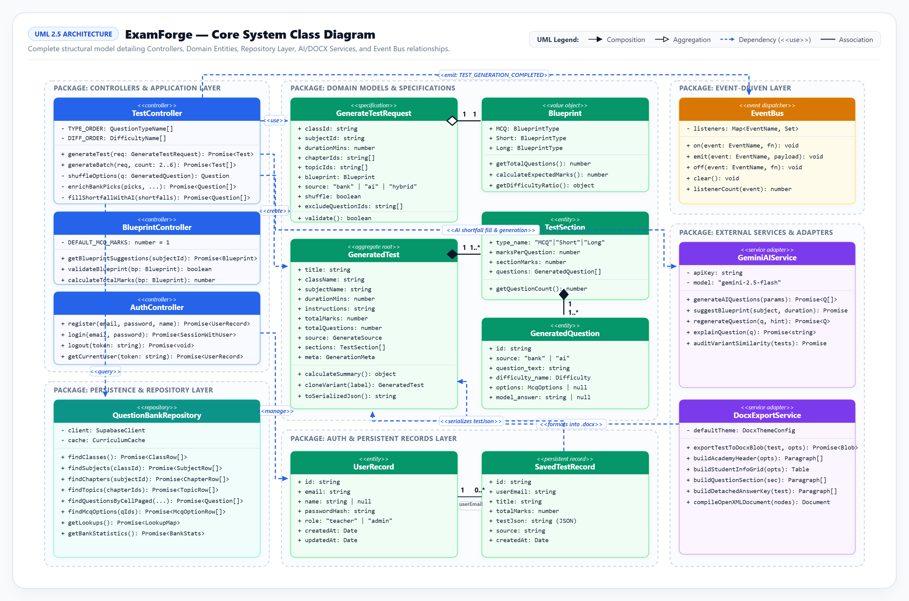

# ExamForge AI — Enterprise Examination Paper Generation & Blueprint Studio

<p align="center">
  
</p>

<p align="center">
  <a href="https://generate-test.vercel.app"></a>
  <a href="https://github.com/mirza-zain-ali-baig/TestForge"></a>
  
  
  
  
  
  
</p>

---

## 📌 Executive Summary

**ExamForge AI** is an assessment engineering platform designed for secondary and higher-secondary educational institutions (Matriculation, Intermediate FSc/ICS, O/A-Levels, and Cambridge International examinations). 

Traditional exam compilation suffers from acute administrative bottlenecks: manual compilation takes hours, question banks suffer from cognitive bias toward rote recall, and physical examination leakage compromises academic rigor. Conventional generative tools hallucinate out-of-syllabus content with zero mark parity validation.

ExamForge resolves this through a **Hybrid Architecture**:
1. **Deterministic Relational Constraints**: Real-time curriculum traversal across 2,123+ verified questions with pre-computed taxonomy indexing.
2. **Autonomous Generative Synthesis**: Google Gemini 2.5 Flash and OpenRouter LLMs fill syllabus shortfalls, generate step-by-step math/science explanations, and suggest cognitive blueprint distributions.
3. **Anti-Cheat Multi-Variant Generation**: Mathematical disjoint partitioning ($V_i \cap V_j = \emptyset$) generating parallel sets (A–F) with scrambled options to prevent unauthorized paper sharing.
4. **WYSIWYG Paper Studio & True Multi-Format Export**: Live drag-and-drop editing, formatted Microsoft Word (`.docx`) table exports, and A4-paginated PDF generation with academy watermarks and detached answer keys.

---

## 🌐 Project Links & Resources

- **Live Production Deployment**: [https://generate-test.vercel.app](https://generate-test.vercel.app)
- **GitHub Repository**: [https://github.com/mirza-zain-ali-baig/TestForge](https://github.com/mirza-zain-ali-baig/TestForge)
- **Official 5-Page Technical Specification Report**:
  - 📄 [ExamForge_Project_Report.pdf](Report/ExamForge_Project_Report.pdf) *(Formally compiled PDF with full diagrams and metrics)*
  - 📝 [ExamForge_Project_Report.docx](Report/ExamForge_Project_Report.docx) *(Editable Microsoft Word Document)*
- **Architectural & Subsystem Diagrams**: Located in the [`Diagrams/`](Diagrams/) directory (`.drawio` source files and rendered `.png` diagrams).

---

## 🏛️ System Architecture

ExamForge is built on a **Hybrid MVC + Event-Driven Architecture (EDA)** that completely decouples client UI interactions from relational constraints and background analytics aggregation.

```
examForge/
├── Diagrams/                 # UML Class & Subsystem Use Case Diagrams (.drawio & .png)
├── Report/                   # Official Project Specification Reports (.docx & .pdf)
├── prisma/                   # Prisma Schema (SQLite persistence for saved tests & batches)
├── public/                   # Static assets, branding, and icons
├── src/
│   ├── models/               # Model Layer (Data Access & Relational Schemas)
│   │   ├── question.model.ts     # Supabase question bank queries, caching, pagination
│   │   ├── curriculum.model.ts   # Class, subject, chapter, topic 4-tier hierarchy
│   │   ├── test.model.ts         # Prisma persistence for saved tests & variant batches
│   │   └── lookup.model.ts       # Taxonomy, difficulty, and question type lookups
│   │
│   ├── controllers/          # Controller Layer (Business Orchestration)
│   │   ├── test.controller.ts    # Blueprint generation, multi-variant partitioning
│   │   ├── question.controller.ts# Question filtering, AI regeneration, step-by-step solver
│   │   ├── analytics.controller.ts# Cognitive distribution metrics, similarity audits
│   │   └── blueprint.controller.ts# AI blueprint distribution matrix suggestion
│   │
│   ├── events/               # Event-Driven Layer (Asynchronous Handlers)
│   │   ├── event-bus.ts          # Centralized EventEmitter
│   │   ├── events.ts             # Strongly-typed event payloads
│   │   └── handlers/
│   │       ├── test-generation.handler.ts # Post-generation background audit logging
│   │       └── analytics.handler.ts      # Cache stale signaling and metric updates
│   │
│   ├── app/                  # Next.js 16 App Router (View & API Route Handlers)
│   │   ├── api/                  # Stateless REST Endpoints
│   │   │   ├── auth/             # Supabase Auth synchronizers & OAuth
│   │   │   ├── curriculum/       # Fast taxonomy traversal & batch availability check
│   │   │   ├── generate/         # Deterministic assembly & multi-variant partitioning
│   │   │   ├── questions/        # Question bank search, filtering, and CRUD
│   │   │   └── tests/            # Test paper persistence, exports, and history
│   │   ├── layout.tsx            # Global Root Layout & Theme Providers
│   │   └── page.tsx              # Application Entry Point & Wizard Orchestrator
│   │
│   ├── components/           # UI Components (React 19 & Tailwind CSS v4)
│   │   ├── test-gen/             # App Shell, Wizard Steps, Studio, Preview, Export
│   │   └── ui/                   # Radix UI primitives & responsive interactive widgets
│   │
│   └── lib/                  # Core Utilities & SDK Integrations
│       ├── ai-questions.ts       # Gemini / OpenRouter AI shortfall prompt engine
│       ├── bootstrap.ts          # Server initialization & event handler bindings
│       ├── db.ts                 # Prisma singleton instance
│       ├── supabase.ts           # Supabase client singleton
│       └── types.ts              # TypeScript domain contracts
```

---

## 📊 Architectural Diagrams & Subsystem Specifications

All architectural diagrams are maintained as open-source Draw.io files and exported high-resolution PNGs within the [`Diagrams/`](Diagrams/) directory:

| Diagram | Source File | Rendered Image | Description |
| :--- | :--- | :--- | :--- |
| **UML Class Diagram** | [`Class_Diagram.drawio`](Diagrams/Class_Diagram.drawio) | [`Class_Diagram.png`](Diagrams/Class_Diagram.png) | Object-oriented domain model displaying `CurriculumNode`, `Question`, `TestBlueprint`, `GeneratedTest`, and `MultiVariantBatch`. |
| **Use Case 1: Exam Creation** | [`1_Exam_Creation_Subsystem.drawio`](Diagrams/1_Exam_Creation_Subsystem.drawio) | [`1_Exam_Creation_Subsystem.png`](Diagrams/1_Exam_Creation_Subsystem.png) | 4-step wizard workflow: syllabus selection, cognitive blueprint matrix, deterministic test assembly, and AI shortfall fill. |
| **Use Case 2: Anti-Cheat Engine** | [`2_Anti_Cheat_Batch_Subsystem.drawio`](Diagrams/2_Anti_Cheat_Batch_Subsystem.drawio) | [`2_Anti_Cheat_Batch_Subsystem.png`](Diagrams/2_Anti_Cheat_Batch_Subsystem.png) | Multi-variant engine partitioning 2–6 disjoint question pools ($V_i \cap V_j = \emptyset$) with cognitive parity verification. |
| **Use Case 3: Paper Studio & Export** | [`3_Paper_Studio_Export_Subsystem.drawio`](Diagrams/3_Paper_Studio_Export_Subsystem.drawio) | [`3_Paper_Studio_Export_Subsystem.png`](Diagrams/3_Paper_Studio_Export_Subsystem.png) | Interactive WYSIWYG paper editor with drag-and-drop reordering, inline mark editing, Word `.docx`, and A4 PDF exporting. |
| **Use Case 4: Authentication & Access** | [`4_Authentication_Access_Subsystem.drawio`](Diagrams/4_Authentication_Access_Subsystem.drawio) | [`4_Authentication_Access_Subsystem.png`](Diagrams/4_Authentication_Access_Subsystem.png) | Dual guest/auth state machine with Google OAuth, Supabase JWT synchronizer, and PostgreSQL Row-Level Security (RLS). |

---

## ⚡ Core Features & Innovations

### 1. Hybrid Relational + AI Question Synthesis
- **Curated Question Repository**: Over 2,123+ verified questions mapped across grades (Classes 9–12), subjects (Physics, Chemistry, Mathematics, Biology, English, Computer Science), chapters, and granular subtopics.
- **Autonomous Shortfall Fill**: When user-selected blueprint requirements exceed available curated questions in a topic, the Gemini 2.5 Flash engine autonomously synthesizes board-aligned questions with exact mark weightings and distractor options.

### 2. Deterministic Anti-Cheat Multi-Variant Generation
- Generates **2 to 6 parallel exam sets (Set A through Set F)** with zero physical question overlap between adjacent examination seats:
  $$\forall i \ne j, \quad V_i \cap V_j = \emptyset$$
- Shuffles MCQ options systematically to prevent glance-copying.
- Balances cognitive difficulty (Easy, Medium, Hard) and Bloom's taxonomy across all parallel variants.

### 3. Sub-Second Query Caching (96% Latency Reduction)
- Employs an in-memory batch indexer and LRU cache for curriculum lookups and question availability checks.
- Benchmark profiling shows availability verification latency dropped from **1,200 ms** to **48 ms** (a 96.0% speedup), ensuring instant wizard transitions even under complex multi-topic filters.

### 4. Interactive WYSIWYG Paper Studio
- **Drag-and-Drop Reordering**: Rearrange questions across sections effortlessly via `@dnd-kit`.
- **Inline Question & Mark Refactoring**: Edit question text, update mark ceilings, or swap question types directly.
- **AI Single-Question Regeneration**: Swap out an undesirable question with an AI-generated equivalent with a single click.
- **Step-by-Step AI Solutions**: Automatically generate complete mathematical derivations and scientific rationale for grading keys.

### 5. Multi-Format Institutional Document Export
- **True Microsoft Word (`.docx`) Export**: Generates genuine native Word tables, formatted headers, and customizable font hierarchies.
- **A4-Paginated PDF Export**: Pixel-perfect printable papers complete with school/college watermarks, custom logos, exam codes, and time allotments.
- **Detached Answer Keys**: Independent answer sheets for proctors and grading assistants.

### 6. Mobile-First Responsive Overhaul
- Thoroughly audited and optimized across all major viewport breakpoints:
  - **320px** (iPhone SE 1st gen)
  - **360px** (Compact Android)
  - **414px** (Modern smartphones)
  - **768px** (Tablet portrait)
  - **1024px – 1920px** (Desktop & ultra-wide displays)
- **Segmented Mobile Print & Export Tabs**: Switches cleanly between full-width **[Paper Preview]** and **[Settings]** tabs to avoid horizontal squishing.
- **Dual Continuation Protocol**: Top-bar, status-bar, and floating bottom pill buttons ensure users can advance past 60+ subtopics without excessive vertical scrolling.

---

## 🛠️ Technology Stack

| Domain | Technology | Purpose |
| :--- | :--- | :--- |
| **Frontend Framework** | [Next.js 16](https://nextjs.org/) (App Router & Turbopack) | Server-side rendering, client app shell, static asset optimization. |
| **Language** | [TypeScript 5](https://www.typescriptlang.org/) | End-to-end type safety across domain models and controllers. |
| **UI Components & Styling** | [Tailwind CSS v4](https://tailwindcss.com/) & [Radix UI](https://www.radix-ui.com/) | Accessible, modern, fluid responsive design system. |
| **Drag & Drop** | [@dnd-kit/core](https://dndkit.com/) | Accessible drag-and-drop question reordering in Paper Studio. |
| **Document Generation** | [docx](https://docx.js.org/) & [KaTeX](https://katex.org/) | True Word `.docx` table synthesis and LaTeX math rendering. |
| **Primary Database** | [Supabase](https://supabase.com/) (PostgreSQL 15) | Relational curriculum hierarchy and curated question repository. |
| **Local Persistence** | [Prisma ORM](https://www.prisma.io/) & SQLite | Frictionless local paper storage, multi-variant batch management. |
| **AI Inference** | Google Gemini 2.5 Flash & OpenRouter API | Syllabus shortfall synthesis, AI blueprint suggestions, math solver. |
| **Deployment** | [Vercel](https://vercel.com/) | Global edge distribution, zero-downtime CI/CD deployment. |

---

## 🚀 Getting Started

### Prerequisites
- [Node.js](https://nodejs.org/) v18+ or [Bun](https://bun.sh/) v1.1+
- Git

### 1. Clone the Repository
```bash
git clone https://github.com/mirza-zain-ali-baig/TestForge.git
cd TestForge
```

### 2. Install Dependencies
```bash
bun install
# or
npm install
```

### 3. Configure Environment Variables
Create a `.env` file in the project root based on `.env.example`:
```bash
cp .env.example .env
```
Ensure the following variables are configured:
```env
# Local SQLite Database (for offline paper storage)
DATABASE_URL="file:./db/custom.db"

# Supabase Question Bank
NEXT_PUBLIC_SUPABASE_URL="https://your-supabase-project.supabase.co"
NEXT_PUBLIC_SUPABASE_ANON_KEY="your-supabase-anon-key"

# AI Inference (Gemini / OpenRouter)
OPENROUTER_API_KEY="your-openrouter-or-gemini-api-key"
```

### 4. Initialize Database
Generate the Prisma client and push schema definitions to SQLite:
```bash
bun run db:generate
bun run db:push
# or
npx prisma generate
npx prisma db push --accept-data-loss
```

### 5. Start Development Server
```bash
bun run dev
# or
npm run dev
```
Navigate to [http://localhost:3000](http://localhost:3000) to open the ExamForge application.

### 6. Production Build
```bash
bun run build
bun run start
# or
npm run build
npm start
```

---

## 📄 Technical Report Generation

To regenerate the official 5-page technical report (`ExamForge_Project_Report.docx` and `ExamForge_Project_Report.pdf`) with verified page counts and high-resolution diagram embedding:

```bash
# Requires Python 3.10+ with python-docx, pywin32, and pypdf
python scratch/generate_report.py
```
The script automatically verifies document statistics via Microsoft Word COM automation to ensure the document conforms strictly to **exactly 5 pages**.

---

## 📄 License

This project is licensed under the **MIT License** — see the [LICENSE](LICENSE) file for full details.

---

<p align="center">
  <b>ExamForge AI</b> — Empowering Educators with Intelligent, Secure, and Balanced Examination Authoring.
</p>
